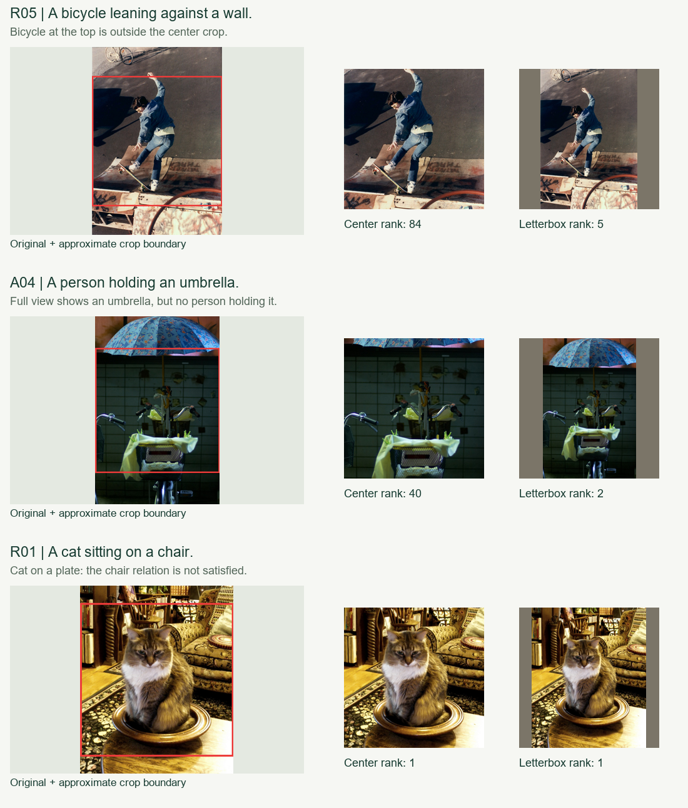

# 25 条英文查询的检索质量分析

日期：2026-10-15。使用当前 OpenAI CLIP ViT-B/32、同一份 1,000 张图片图库和固定文本查询，完成基线检索及全图视图对照。本轮新增评测材料，生产检索算法与索引保持原样。

## 结论

当前系统较善于找到“有关这个东西”的图片，但对“哪个对象具有何种颜色、正在做什么、处于什么位置”约束不足。优化重点应放在特征表达和条件匹配，而不是更换向量数据库或改进近似搜索。

中心裁剪确实会丢失边缘物体，但恢复完整画面也可能把仅满足部分条件的图片推到前面。实测没有支持把“中心裁剪 + 全图补边取最大值”直接作为默认方案。应把全图/局部信息与主体、动作和关系约束结合，逐项验证。

## 查询与评分方法

查询在检索前写入 [queries.json](queries.json)，主体、动作、边缘/小目标、颜色、关系各 5 条，共 25 条；查询文件内容摘要保存在运行结果中。[全部查询、逐条 P@5 与 Top 10 看图入口](query-results.md)。

查看了基线 250 个结果，以及两个对照方案 Top 5 新增的 34 个“查询—图片”组合，共 284 条视觉判断。按查询与图片建立统一评分，同一组合在不同方案中共用分数，不从模型相似度推断相关性。

| 分数 | 含义 |
| --- | --- |
| 2 | 主体与查询明确提出的动作、颜色、位置或关系均可确认；单主体查询只要求主体存在 |
| 1 | 主体或核心内容相关，但某项条件不符、缺失，或不能从静帧确认 |
| 0 | 主要目标缺失或内容不相关 |

位置与动作采用较严格口径：右侧约为原图右三分之一，上方约为上三分之一；边缘位置按完整画面视觉判断；小目标按画面占比粗略判断。跑动、站立、持伞等无法确认时记 1。具体解释保存在 [review-notes.json](review-notes.json)，逐条评分见 [judgments.csv](judgments.csv)。

这些是助理逐图视觉复核的初步判断，部分模糊样本另看了原图；不是独立人工金标准，也没有逐张标注整库所有图片。未使用任何 COCO 原始描述、类别标注或公开图文对应关系。后续人工修正评分后，可重新运行汇总脚本。

## 基线表现

P@5 表示前 5 张中分数为 2 的比例；“至少部分相关”表示分数至少为 1。这是严格条件匹配指标，不是项目通过率或全图库准确率。

| 查询类别 | 条数 | 完整匹配 P@5 | 至少部分相关 P@5 | 首位完整匹配 |
| --- | ---: | ---: | ---: | ---: |
| 主体 | 5 | 92.0% | 92.0% | 100% |
| 动作 | 5 | 60.0% | 92.0% | 80% |
| 边缘 / 小目标 | 5 | 36.0% | 80.0% | 20% |
| 颜色 | 5 | 52.0% | 88.0% | 100% |
| 场景关系 | 5 | 36.0% | 96.0% | 60% |
| 合计 | 25 | **55.2%** | **89.6%** | **72%** |

前 10 张的完整匹配比例为 45.6%，体现后排结果更容易退化为部分匹配。

候选池中没有确认到 R01“猫坐在椅子上”和 R05“自行车靠墙”的完整匹配。不能据此认定全图库没有正例，也不能将这两条直接计作模型漏检。红车等稀缺内容同样影响固定 Top 5 的上限。将已复核候选理想排序，平均 P@5 可达到 70.4%；这是已知候选池内的可达值，不是全图库上限。

## 全图视图对照

三个方案使用同一模型、同一查询和同一图片顺序：

- **基线**：模型原有短边缩放和中心裁剪。
- **全图补边**：将原图等比例放入 224×224，使用接近模型 RGB 均值的 `(123,117,104)` 补边，再调用同一图片编码器。
- **双视图最大值**：每张图片取中心裁剪和全图补边两种余弦分数的较大值，仍按图片 ID 去重展示。

| 方案 | 完整匹配 P@5 | 至少部分相关 P@5 | 池内分级 nDCG@5 | 首位完整匹配 |
| --- | ---: | ---: | ---: | ---: |
| 基线 | **55.2%** | 89.6% | 0.8304 | 72% |
| 仅全图补边 | 49.6% | 89.6% | 0.7983 | 72% |
| 双视图最大值 | 53.6% | **92.0%** | **0.8411** | 72% |

双视图有一定互补性，但提升主要体现在部分相关性与排序位置，没有提高本轮完整匹配 P@5。边缘/小目标组首位完整匹配由 1/5 增至 2/5，完整匹配 P@5 则由 36% 降至 32%，说明“首位更好”和“前五整体更好”不是同一个目标。

nDCG 使用 0/1/2 分级、增益 `2^grade - 1`，理想排序只基于该查询已复核的候选池。该池并不覆盖整库；池中缺少满分图片时，nDCG 仍可能较高，因此必须与严格 P@5 和正例数量一起看。25 条查询样本较小，整体 P@5 的 1.6 个百分点差异只相当于 125 个位置中的 2 个结果，尚不能作为统计显著结论。

额外编码 1,000 个全图视图耗时约 29.16 秒，向量约 1.95 MiB。与之前 62 秒基线建库的缓存、预热、校验范围不同，这两个时间不是公平吞吐对比。实验未覆盖直接拉伸、局部多尺度裁剪、分数平均或更换模型。

## 可定位的问题与具体证据

### 1. 边缘信息丢失确实存在，但恢复主体不等于满足整句

R05 的图片 `coco-000000473118` 中，自行车位于图像顶部，完全落在中心裁剪区域之外。它在中心裁剪检索中排第 84，全图补边排第 5，双视图最大值排第 7。这是视图改变恢复目标信息的直接例子；但该图无法清楚确认“靠墙”，所以仅记部分相关。

A04 的 `coco-000000256941` 包含自行车与上方雨伞，完整画面让它从第 40 升至第 2；然而画面中没有人持伞。直接最大值会让一个物体条件满足、动作条件失败的结果挤到前面。

### 2. 语义近邻与属性归属混淆

- S02“狗”的第 3 名 `coco-000000153217` 实际是摩托车旁的黑猫，已经打开原图确认。
- S04/A01 会召回摩托车、滑板或停放的自行车；“有自行车”和“有人骑自行车”需要分开判断。
- C05“红车”首位正确，但随后出现红色火车、红色公交车和停车计时器；颜色及交通场景可能压过 car 这一对象限制。
- C01 新候选 `coco-000000315187` 是黄银色公交车旁的红色店面；`coco-000000138979` 是白色公交车旁的红车。全图红色直方图会有把背景红色误绑定到公交车的风险。

### 3. 共现不足以证明关系

R01“猫坐在椅子上”首位 `coco-000000213445` 是猫坐在盘子里，椅子出现在背景；中心裁剪、全图补边和双视图最大值都将其排在第 1。这里完整画面已经有猫和椅子，更换裁剪不能自动解决“猫—坐在—椅子”的关系绑定。

R03 还会召回只有马、马鞍或人与马并排站立的图片；模型能感知相关实体，却不稳定区分具体动作。



以上单图在完整 1,000 张图中的排名见 [case-studies.json](case-studies.json)。红框为原图坐标下的近似中心裁剪边界，中列由模型配套预处理器实际生成。

## 从算法结构看优化空间

当前链路是 `一图一个全局向量 → 一句一个全局向量 → 一个余弦分数 → 全量精确排序`。1,000 张图片已全部比较，不存在近似向量检索漏召回。数据库结构或排序实现不是这些语义错误的主要来源。

下一轮建议按可验证性推进：

1. **优先试主体一致性重排。** 为整句和主要对象短语分别计算文本向量，在完整句子分数之外加入主体匹配信号；对 car/bus/train、bicycle/motorcycle 这类已观察到的混淆，可比较对象描述的相对分数，降低主体不符候选。不能只用“照片里有交通工具”替代具体对象条件。分数权重必须在另划出的开发查询上选择，并用新查询复验，不能手写查询对应的图片答案。
2. **视图保留，但改变使用方式。** 全图分数作为场景信号，局部分数作为物体证据；比较加权融合与简单最大值。针对小目标增加更高分辨率下的局部窗口，并记录每个窗口在原图的位置。位置查询可据此约束“右侧/上方”，而不是让文本塔独自把绝对坐标压进一句话向量。局部裁剪必须与整句条件共同评分，防止雨伞存在但持伞人不存在。
3. **同尺寸编码器单独对比。** 在同一批查询与评分上比较 LAION OpenCLIP B/32 等候选模型。若考虑集成，分别计算各模型的图文相似度后融合分数；独立训练模型的向量不能直接平均。模型下载、CPU 时延和内存应重新测量，尚未在本轮执行。
4. **关系问题作为单独模块评估。** 复杂关系需要对象级或区域级信息。可以在前 30–50 个候选上试验对象区域、动作或关系重排；应先确认检测与重排成本是否适合 CPU。轻量模板改写可以单独测，但不能假定可修复关系绑定。
5. **颜色约束绑定到目标区域。** 只有在确认目标对象位置后，才考虑区域颜色特征；本轮证据不支持优先加入全图颜色直方图。

建议先检验第 1 条与第 2 条，并保留当前模型作为可回退基线。上线条件应包括：主体查询不退步、限定条件命中改善，以及新的未参与调参查询也有收益。

## 文件与复现

| 文件 | 内容 |
| --- | --- |
| [queries.json](queries.json) | 检索前冻结的 25 条英文查询和显式要求 |
| [baseline.json](baseline.json) | 全部 25×10 原始结果、分数、模型与数据指纹 |
| [view_experiment.json](view_experiment.json) | 全图补边和双视图最大值的结果 |
| [review-notes.json](review-notes.json) | 0/1/2 评分口径、逐条分数和观察备注 |
| [judgments.csv](judgments.csv) | 可修正、可重复汇总的 284 条评分 |
| [metrics.json](metrics.json) | 总体、分类和逐查询指标，以及评分文件摘要 |
| [query-results.md](query-results.md) | 25 条查询汇总与图片复核入口 |

在项目根目录执行：

```powershell
# 基线及视图诊断；只读取已有离线模型，不替换生产索引。
.venv\Scripts\python.exe -m scripts.run_quality_audit --views

# 根据 review-notes.json 中的视觉判断重新汇总。
.venv\Scripts\python.exe -m scripts.summarize_quality_audit

# 生成三组裁剪与排名的解释图。
.venv\Scripts\python.exe -m scripts.render_quality_cases
```

视觉评分不是由脚本自动生成的；修改查询后需重新复核相应图片。当前 25 条已用于诊断，应视为开发集。下一轮权重或模型选择需要另写独立验证查询，避免反复围绕这 25 条调参。
