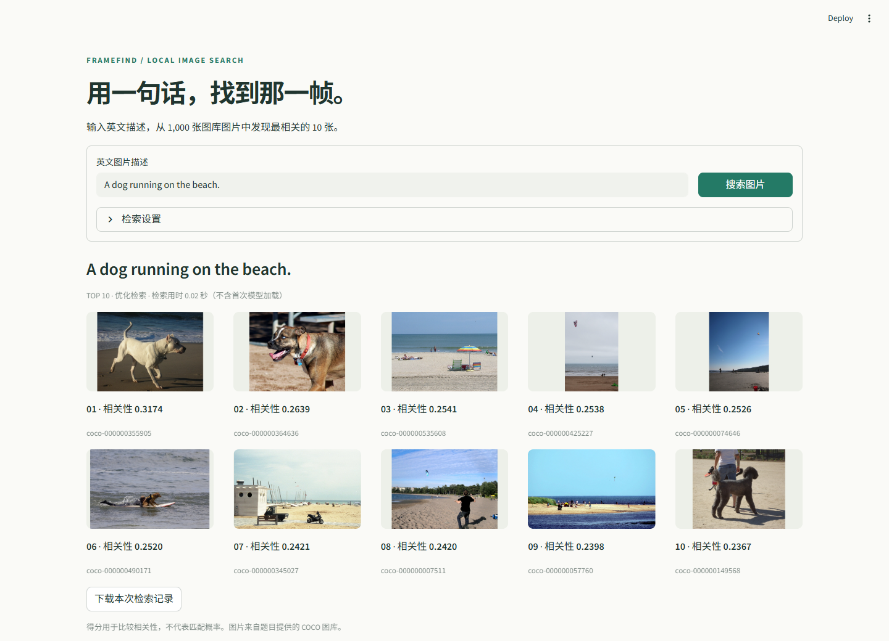
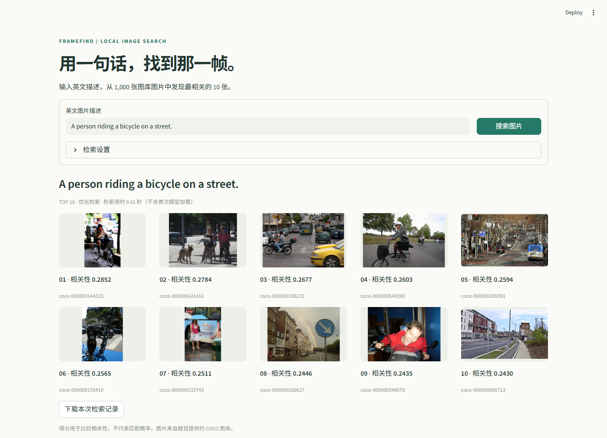

# 三组实际检索示例

以下结果由本项目的默认优化检索对完整 1,000 张图库图片实时检索产生，未使用 COCO 原始描述、类别标注或公开图文对应关系。截图来自运行中的 Streamlit 页面，保留了完整的前 10 张结果；JSON 同时保存排序规则版本与原始 CLIP 得分。

| 英文查询 | 结果记录 | 页面截图 |
| --- | --- | --- |
| A dog running on the beach. | [query-1.json](query-1.json) | [query-1.png](query-1.png) |
| A person riding a bicycle on a street. | [query-2.json](query-2.json) | [query-2.png](query-2.png) |
| A plate of food on a table. | [query-3.json](query-3.json) | [query-3.png](query-3.png) |

视觉观察：第一组首位是海滩上的狗；第二组首位是街头骑自行车的人；第三组靠前结果体现餐盘和食物。后排结果仍存在只符合部分内容的情况，例如海滩场景、街景，或带杯子的装饰时钟。三组示例用于展示实际表现，不代表整个图库上的准确率评测。

## 运行验证

实际环境：Windows 11、Python 3.12.14、CPU 推理，机器物理内存约 31.8 GiB。

| 项目 | 本机测量 |
| --- | --- |
| 完整图库建库 | 61.99 秒，batch size 8，4 个 CPU 推理线程 |
| 建库进程峰值工作集 | 801.66 MiB |
| 搜索引擎首次加载、图库校验及对象文本原型准备 | 5.26 秒 |
| 查询 1 / 2 / 3 | 0.0144 / 0.0126 / 0.0242 秒 |
| 命令行评估进程峰值工作集 | 567.15 MiB |

精确测量记录见 [verification.json](verification.json)。查询耗时不包含模型加载；内存是 Windows 进程峰值工作集，不包含浏览器和操作系统，也不是整机峰值内存。当前机器有 32 GB 内存，尚未在物理 8 GB 机器上实测。上述进程占用为满足题目内存限制提供参考。

每个示例均检查：10 张不同 ID、图片存在、相关性得分降序、相同查询重复执行结果一致。浏览器验证结果见 [browser-verification.json](browser-verification.json)，包括图片显示、与 JSON 的 ID 顺序一致、连续提交，以及空输入和超长输入处理。

## 重新生成

先按根目录 `RUNNING.md` 准备环境和索引：

```powershell
.venv\Scripts\python.exe -m src.evaluate --offline
.venv\Scripts\python.exe -m streamlit run app.py
```

随后在页面分别输入三组查询并截图。也可在安装 Node.js、Playwright 包和 Microsoft Edge 后，运行 `node scripts/capture_examples.cjs` 自动截图和检查。浏览器截图工具仅用于开发验证，不是运行搜索程序的依赖。






